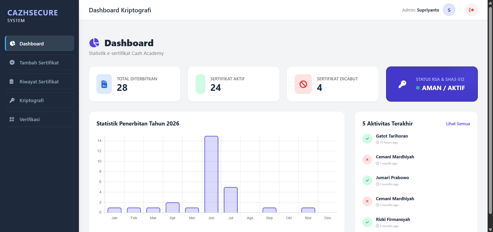
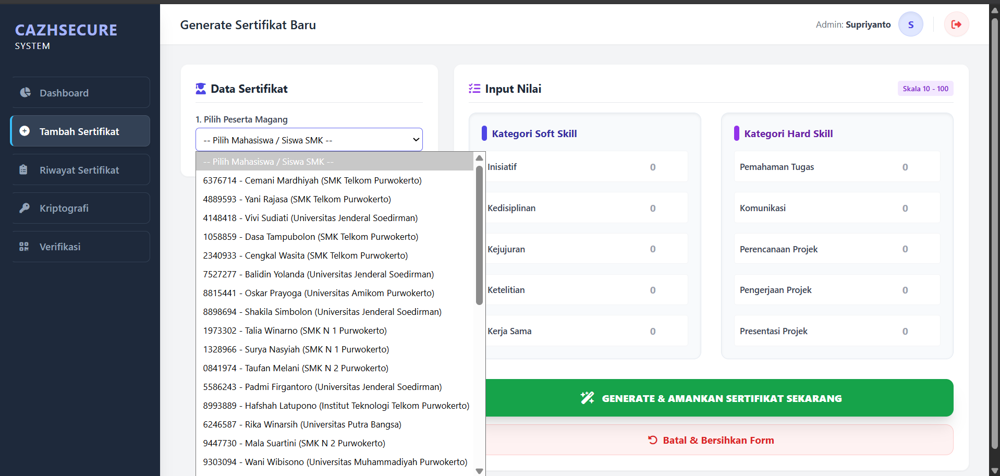
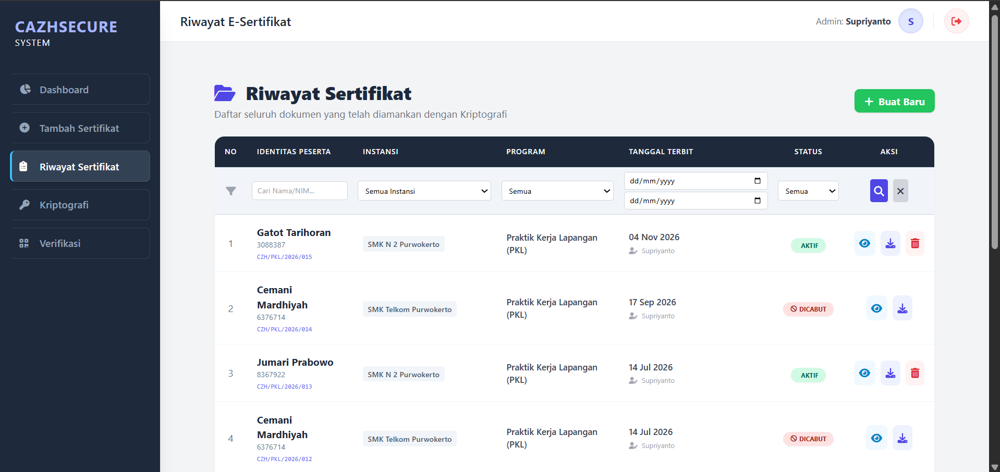
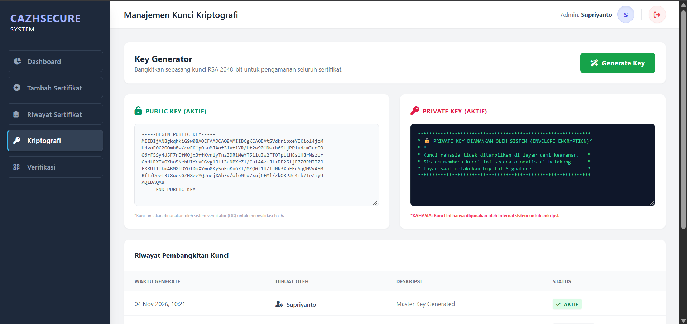
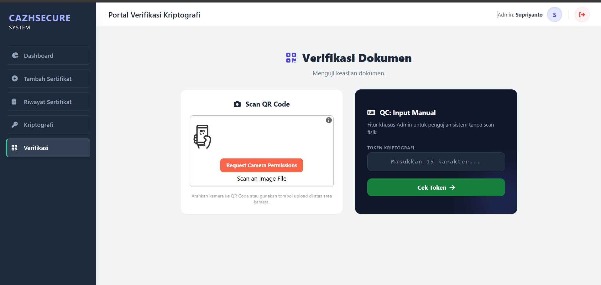
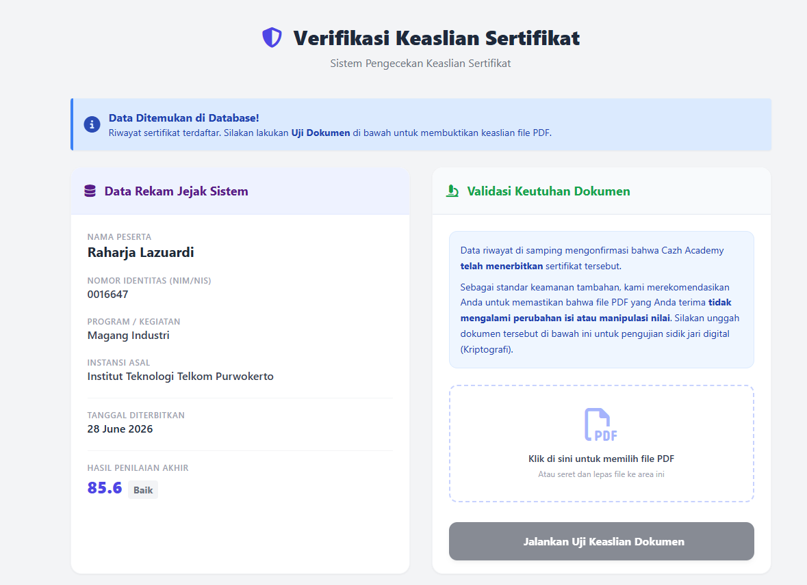
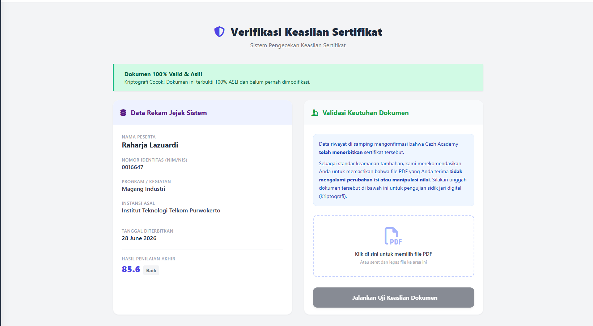
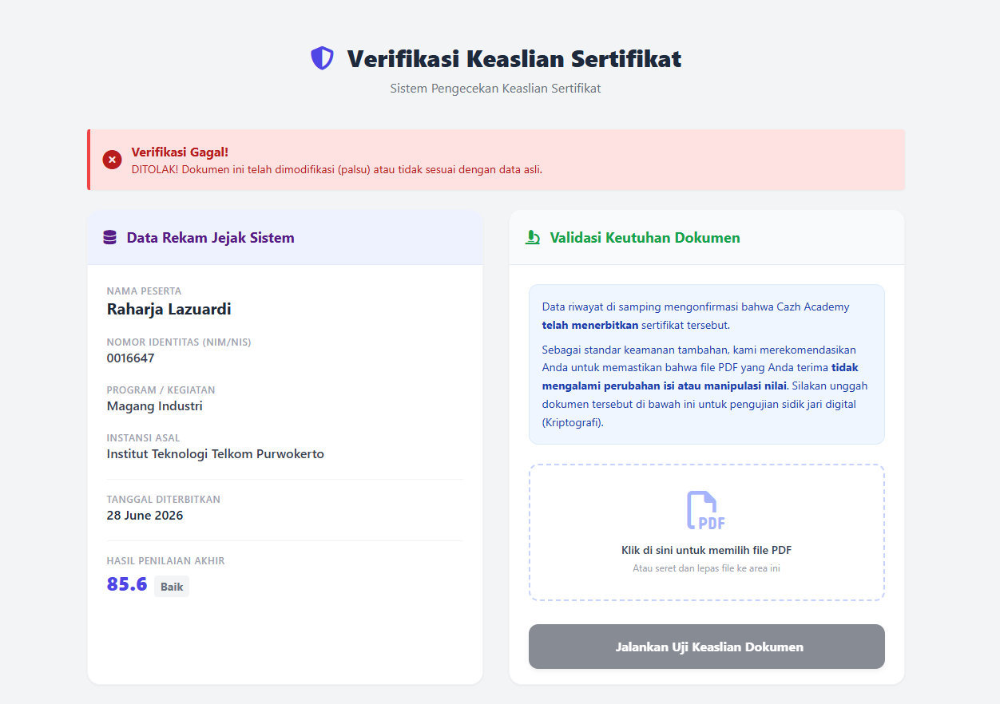

# 🛡️ CAZHSECURE - Sistem Verifikasi E-Sertifikat Berbasis Kriptografi

Sistem Informasi terpusat untuk penerbitan, pengelolaan, dan validasi keaslian E-Sertifikat. Dikembangkan sebagai Tugas Akhir (Skripsi) untuk memitigasi maraknya pemalsuan dokumen digital melalui implementasi kriptografi tingkat lanjut.

##  Latar Belakang & Solusi (Problem Statement)
Pemalsuan e-sertifikat sering kali luput dari pemeriksaan karena lemahnya sistem verifikasi konvensional yang hanya mengecek data visual. **CAZHSECURE** hadir sebagai solusi *end-to-end* dengan mengunci integritas dokumen menggunakan **Digital Signature (RSA 2048-bit)** dan **SHA3-512 Hashing**. 

Jika ada oknum yang mengubah satu karakter saja pada file PDF menggunakan PDF Editor, sistem akan secara matematis mendeteksi perubahan tersebut dan menyatakan dokumen **TIDAK VALID**.

## Tampilan Antarmuka Sistem

Berikut adalah dokumentasi visual dari fitur-fitur utama dan pengujian keamanan pada sistem CAZHSECURE:

<table align="center">
  <tr>
    <td align="center" width="50%">
      <b>1. Dashboard Admin</b><br>
      <br>
      <i>Ringkasan statistik dan status kriptografi RSA.</i>
    </td>
    <td align="center" width="50%">
      <b>2. Tambah Sertifikat</b><br>
      <br>
      <i>Input nilai dan injeksi QR Code ke PDF.</i>
    </td>
  </tr>
  <tr>
    <td align="center" width="50%">
      <b>3. Riwayat Sertifikat</b><br>
      <br>
      <i>Manajemen data, filter, dan pencabutan sertifikat.</i>
    </td>
    <td align="center" width="50%">
      <b>4. Membuat Kunci RSA</b><br>
      <br>
      <i>Generator Public & Private Key 2048-bit.</i>
    </td>
  </tr>
  <tr>
    <td align="center" width="50%">
      <b>5. Quality Control (QC)</b><br>
      <br>
      <i>Pemindaian QR Code via Webcam atau upload gambar.</i>
    </td>
    <td align="center" width="50%">
      <b>6. Hasil Scan QR</b><br>
      <br>
      <i>Validasi token dan detail sertifikat.</i>
    </td>
  </tr>
  <tr>
    <td align="center" width="50%">
      <b>7. Verifikasi: File Asli</b><br>
      <br>
      <i>Dokumen valid (Hash SHA3-512 cocok dengan RSA).</i>
    </td>
    <td align="center" width="50%">
      <b>8. Verifikasi: File Palsu</b><br>
      <br>
      <i>Dokumen ditolak karena terdeteksi manipulasi.</i>
    </td>
  </tr>
</table>

##  Fitur Utama
- **Autentikasi & Rate Limiting:** Keamanan login dengan proteksi *brute-force attack* (pemblokiran sementara setelah 5 kali gagal login).
- **Dashboard Analitik:** Visualisasi data statistik penerbitan menggunakan `Chart.js` dan indikator status *real-time* infrastruktur kriptografi.
- **Penerbitan Sertifikat (Generator):** Injeksi data peserta dan QR Code secara otomatis ke dalam template PDF menggunakan library `FPDI`, kemudian dikunci dengan Digital Signature.
- **Manajemen Kunci (Key Management):** Pembangkitan pasangan kunci RSA (Public/Private Key) secara dinamis, dilengkapi fitur *Key Rotation* (menonaktifkan kunci lama otomatis untuk mencegah bentrok).
- **Verifikasi Internal (Quality Control):** Pemindaian QR Code via Webcam (kamera) atau *upload* gambar, serta pengecekan token manual sebelum sertifikat dirilis.
- **Verifikasi Publik:** Portal *drag-and-drop* PDF untuk publik (HRD/Instansi) guna memvalidasi keaslian dokumen secara mandiri dan *real-time*.
- **Riwayat & Pencabutan:** Manajemen pelacakan (*traceability*) sertifikat, dilengkapi fitur pencarian majemuk (multi-filter) dan opsi pencabutan sertifikat (Revocation).

## Teknologi & Library (Tech Stack)
- **Framework:** Laravel 12.56.0 (PHP 8.2)
- **Database:** MySQL
- **Frontend:** Tailwind CSS, Chart.js, SweetAlert2.
- **Kriptografi:** `phpseclib3` (RSA 2048-bit & SHA3-512).
- **Dokumen & QR:** `setasign/FPDI` (Manipulasi PDF), `SimpleSoftwareIO/QrCode`.

## Hasil Pengujian (Hasil Skripsi)
- **Akurasi Verifikasi:** 100% berhasil memvalidasi 10 dokumen asli dan menolak 10 dokumen yang telah dimanipulasi.
- **Sensitivitas Hash (Avalanche Effect):** 51,56% (Standar ideal kriptografi adalah 45%-60%). Membuktikan SHA3-512 sangat sensitif terhadap manipulasi data sekecil apa pun.
- **Performa:** Rata-rata waktu eksekusi enkripsi dan penandatanganan dokumen hanya memakan waktu **0.216 detik** (sangat efisien).

## Cara Menjalankan Project Secara Lokal

Jika kamu ingin menjalankan project ini di komputermu sendiri, ikuti langkah-langkah berikut:

1. **Clone repository dan masuk ke direktori:**
   ```bash
   git clone https://github.com/HanifRoi/sertifikat-secure.git
   cd sertifikat-secure
   ```

2. **Install dependensi PHP dan Node.js:**
   ```bash
   composer install
   npm install
   ```

3. **Setup environment & Database:**
   ```bash
   cp .env.example .env
   php artisan key:generate
   ```
   *Buat database baru di MySQL terlebih dahulu, lalu sesuaikan kredensial koneksi database kamu di dalam file `.env`.*

4. **Jalankan migrasi database beserta seeder:**
   ```bash
   php artisan migrate --seed
   ```

5. **Jalankan aplikasi:**
   * **Terminal (Laravel):**
     ```bash
     php artisan serve
     ```

---
Dikembangkan oleh **Hanif Roihan** sebagai Tugas Akhir (Skripsi) Program Studi Ilmu Komputer.
